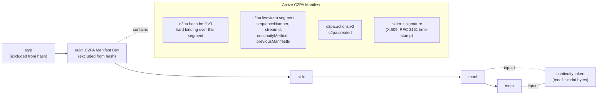
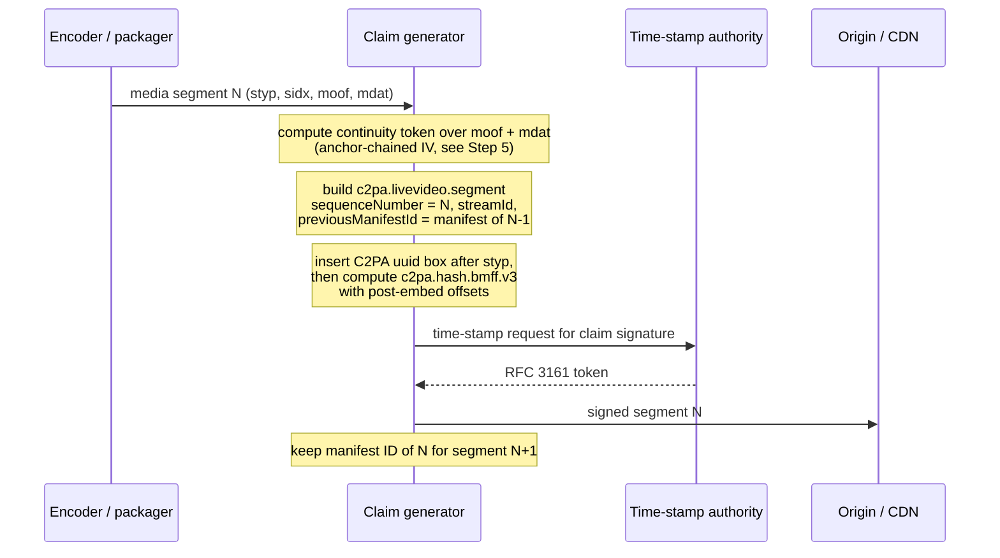
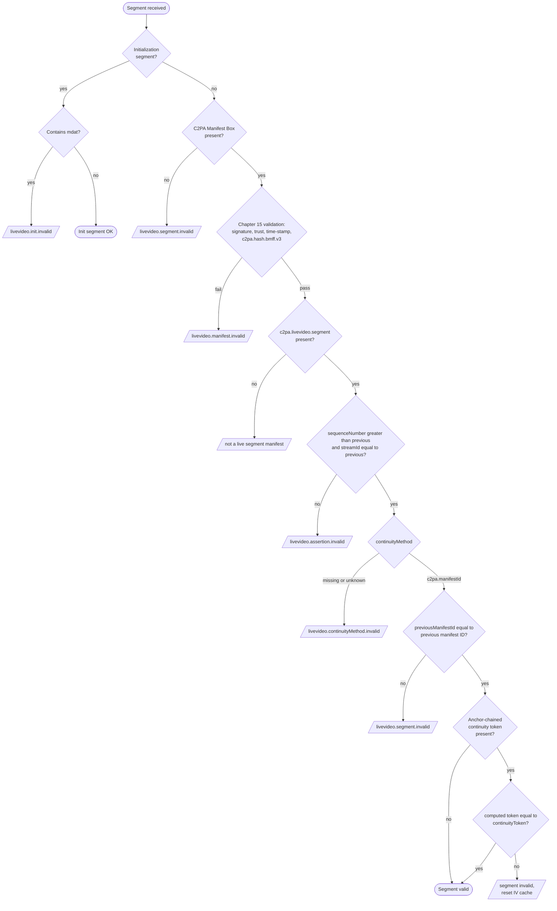
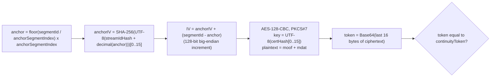

# C2PA Live Segment Validation (Per-segment C2PA Manifest Box method)

This document describes how to validate the live video segments in this
directory. They use the **Per-segment C2PA Manifest Box method** defined in
C2PA 2.3, Section 19.3. Every media segment carries its own C2PA Manifest in a
`uuid` box, and each segment is validated on its own, with continuity checked
against the previous segment. This method does not use session keys or
`verifiable-segment-info` (Section 19.4).

In addition to the checks required by the specification (Section 19.7), the
segments carry an entity-specific **anchor-chained continuity token**. Section
19.3.1 allows this: "Claim generators may derive additional per-segment
validation values (e.g., anchor-point-based chaining values) from segment
hashes and embed them in the Manifest." Validating the token is described in
[Step 5](#step-5-validate-the-anchor-chained-continuity-token).

## Contents

- [Segment structure](#segment-structure)
- [Generation flow](#generation-flow)
- [Validation flow](#validation-flow)
- [Validation steps](#validation-steps)
- [Checking this test set](#checking-this-test-set)
- [Known deviations in the current files](#known-deviations-in-the-current-files)

## Segment structure

Each segment is a self-contained CMAF/fMP4 media segment. The C2PA Manifest Box
is a `uuid` box with the C2PA user type
`d8fec3d6-1b0e-483c-9297-5828877ec481`, placed directly after `styp`.



Files in this directory:

| Folder | Segments | Segment IDs | Signer |
|:--|:--|:--|:--|
| `m4s/` | `seg_803347.m4s` to `seg_803366.m4s` (20) | 803347 to 803366 | DigiCert S/MIME certificate |
| `mp4/` | `segment_11_12517098.mp4` to `segment_11_12517117.mp4` (20) | 12517098 to 12517117 | C2PA test signing certificate |

`example_c2pa_manifest.json` is a decoded dump of the JUMBF manifest store of
`m4s/seg_803366.m4s`.

## Generation flow



## Validation flow



The first segment of a session has no previous segment, so the "previous"
comparisons are skipped for it.

## Validation steps

### Step 1: Check the box structure

Parse the top-level boxes of the segment. A media segment is expected to contain
`styp`, a C2PA `uuid` box, `sidx`, then one `moof` followed by one `mdat`.

- An initialization segment (one that contains `moov`) MUST NOT contain `mdat`,
  otherwise it fails with `livevideo.init.invalid`.
- A media segment without a C2PA Manifest Box fails with
  `livevideo.segment.invalid`.

```ts
type Box = { type: string; start: number; end: number; usertype?: string };

const C2PA_UUID = "d8fec3d61b0e483c92975828877ec481";

function readBoxes(data: Uint8Array): Box[] {
  const view = new DataView(data.buffer, data.byteOffset, data.byteLength);
  const boxes: Box[] = [];
  let pos = 0;
  while (pos + 8 <= data.length) {
    let size = view.getUint32(pos);
    const type = String.fromCharCode(...data.subarray(pos + 4, pos + 8));
    let header = 8;
    if (size === 1) {
      size = Number(view.getBigUint64(pos + 8)); // 64-bit largesize
      header = 16;
    } else if (size === 0) {
      size = data.length - pos; // box extends to end of file
    }
    if (size < header || pos + size > data.length) {
      throw new Error(`malformed box '${type}' at offset ${pos}`);
    }
    const box: Box = { type, start: pos, end: pos + size };
    if (type === "uuid") {
      box.usertype = [...data.subarray(pos + header, pos + header + 16)]
        .map((b) => b.toString(16).padStart(2, "0"))
        .join("");
    }
    boxes.push(box);
    pos += size;
  }
  return boxes;
}

const boxes = readBoxes(segment);
const hasManifestBox = boxes.some((b) => b.type === "uuid" && b.usertype === C2PA_UUID);
```

### Step 2: Validate the C2PA Manifest (Chapter 15)

Validate the manifest with a conforming C2PA validator. This covers the claim
signature, the certificate chain against the validator's trust list, the
time-stamp, and the `c2pa.hash.bmff.v3` hard binding over the segment bytes.
If this fails, the segment fails with `livevideo.manifest.invalid`.

```ts
import { createC2pa } from "@contentauth/c2pa-web";
import wasmSrc from "@contentauth/c2pa-web/resources/c2pa.wasm?url";

const c2pa = await createC2pa({ wasmSrc, settings: toolkitSettings });
const reader = await c2pa.reader.fromBlob("video/mp4", new Blob([segment]));
const store = await reader.manifestStore();
const active = store.manifests[store.active_manifest];
if (store.validation_state === "Invalid") {
  fail("livevideo.manifest.invalid", store.validation_status);
}
```

`toolkitSettings` should load the trust list that the deployment uses. A
manifest signed with a certificate that is not on that list is reported with
`signingCredential.untrusted`.

### Step 3: Read the live video segment assertion

Find the `c2pa.livevideo.segment` assertion in the active manifest. Per
Section 19.3.2 it contains:

| Field | Type | Meaning |
|:--|:--|:--|
| `sequenceNumber` | uint | Monotonically increasing segment number. It matches `mfhd.sequence_number` or follows ISO/IEC 23009-9 segment indexing |
| `streamId` | tstr | Identifier for the whole live stream, for example a UUID |
| `continuityMethod` | tstr | `c2pa.manifestId`, or an entity-specific label |
| `previousManifestId` | tstr | Manifest identifier of the previous segment's manifest (for `c2pa.manifestId`) |

```ts
const seg = active.assertions.find((a) => a.label === "c2pa.livevideo.segment")?.data;
```

### Step 4: Apply the Section 19.7.2 checks

Keep the state of the previous segment of the same stream (`prev.seq`,
`prev.streamId`, `prev.manifestId`). Then:

1. `seg.sequenceNumber` MUST be greater than `prev.seq`. Otherwise:
   `livevideo.assertion.invalid`.
2. `seg.streamId` MUST equal `prev.streamId`. Otherwise:
   `livevideo.assertion.invalid`.
3. `seg.continuityMethod` MUST be present. Otherwise:
   `livevideo.continuityMethod.invalid`.
4. If `continuityMethod` is `c2pa.manifestId`, `seg.previousManifestId` MUST be
   present (otherwise `livevideo.continuityMethod.invalid`) and MUST equal
   `prev.manifestId` (otherwise `livevideo.segment.invalid`).
5. If `continuityMethod` is any other value the validator does not support:
   `livevideo.continuityMethod.invalid`.

```ts
if (prev) {
  if (!(seg.sequenceNumber > prev.seq) || seg.streamId !== prev.streamId) {
    fail("livevideo.assertion.invalid");
  }
}
if (!seg.continuityMethod) fail("livevideo.continuityMethod.invalid");
if (seg.continuityMethod === "c2pa.manifestId") {
  if (!seg.previousManifestId) fail("livevideo.continuityMethod.invalid");
  if (prev && seg.previousManifestId !== prev.manifestId) fail("livevideo.segment.invalid");
} else if (!supportedContinuityMethods.has(seg.continuityMethod)) {
  fail("livevideo.continuityMethod.invalid");
}
prev = { seq: seg.sequenceNumber, streamId: seg.streamId, manifestId: store.active_manifest };
```

### Step 5: Validate the anchor-chained continuity token

This check is specific to this generator. Validators that do not support it
still validate the segment through Steps 1 to 4.

Parameters (currently carried as the `parameters` of a `c2pa.IVHASH` entry in
the `actions` array of `c2pa.livevideo.segment`):

| Parameter | Example (`seg_803366.m4s`) | Meaning |
|:--|:--|:--|
| `segmentId` | `803366` | Segment number used for IV derivation |
| `anchorSegmentIndex` | `10` | An anchor segment occurs every N segments |
| `streamIdHash` | `o1q7p/yXXB+e2q1RXBCUfg==` | Base64 string, seed for the anchor IV |
| `certHash` | `nQXL571qojH4mCYV/g6jMA==` | Base64 string. Its first 16 characters, as UTF-8 bytes, are the AES-128 key |
| `continuityToken` | `w6v7lTW8mQtlLoUVpTuYYg==` | Expected token, Base64 |

If any parameter is missing, the token cannot be checked and the segment is
rejected by this check.



1. **Extract the input bytes.** Concatenate the raw bytes of the `moof` box and
   the `mdat` box that follows it, including their headers. No other box is
   part of the input.
2. **Derive the anchor IV.** `anchor = floor(segmentId / anchorSegmentIndex) *
   anchorSegmentIndex`. `anchorIV` is the first 16 bytes of
   `SHA-256(UTF-8(streamIdHash + String(anchor)))`. `streamIdHash` is used as
   its Base64 string, not decoded.
3. **Advance to the segment IV.** Increment `anchorIV` as a 128-bit big-endian
   integer `segmentId - anchor` times. A validator that holds the IV of the
   previous segment (`segmentId - 1`) and is not at an anchor may increment
   that IV once instead.
4. **Compute the token.** Encrypt the input bytes with AES-128-CBC and PKCS#7
   padding, using `UTF-8(certHash.slice(0, 16))` as the key and the segment IV.
   The token is the Base64 encoding of the last 16 bytes of the ciphertext
   (a CBC-MAC).
5. **Compare.** If the computed token equals `continuityToken`, the check
   passes. Otherwise mark the segment invalid, notify the consumer, and clear
   any cached IV so the next anchor segment starts a clean chain.

```ts
const utf8 = (s: string) => new TextEncoder().encode(s);

function moofAndMdat(data: Uint8Array, boxes: Box[]): Uint8Array {
  const i = boxes.findIndex((b) => b.type === "moof");
  if (i < 0 || boxes[i + 1]?.type !== "mdat") throw new Error("moof + mdat not found");
  return data.slice(boxes[i].start, boxes[i + 1].end);
}

function incrementIv(iv: Uint8Array, times = 1): Uint8Array {
  const out = new Uint8Array(iv);
  for (let n = 0; n < times; n++) {
    for (let i = out.length - 1; i >= 0; i--) {
      out[i] = (out[i] + 1) & 0xff;
      if (out[i] !== 0) break;
    }
  }
  return out;
}

async function segmentIv(segmentId: number, anchorSegmentIndex: number, streamIdHash: string) {
  const anchor = Math.floor(segmentId / anchorSegmentIndex) * anchorSegmentIndex;
  const digest = new Uint8Array(
    await crypto.subtle.digest("SHA-256", utf8(streamIdHash + anchor.toString()))
  );
  return incrementIv(digest.slice(0, 16), segmentId - anchor);
}

async function continuityToken(input: Uint8Array, certHash: string, iv: Uint8Array) {
  const key = await crypto.subtle.importKey(
    "raw", utf8(certHash.slice(0, 16)), { name: "AES-CBC" }, false, ["encrypt"]
  );
  // WebCrypto AES-CBC always applies PKCS#7 padding
  const ct = new Uint8Array(await crypto.subtle.encrypt({ name: "AES-CBC", iv }, key, input));
  return btoa(String.fromCharCode(...ct.slice(-16)));
}

const p = ivHashParameters; // from c2pa.livevideo.segment
const iv = await segmentIv(p.segmentId, p.anchorSegmentIndex, p.streamIdHash);
const token = await continuityToken(moofAndMdat(segment, boxes), p.certHash, iv);
const tokenValid = token === p.continuityToken;
```

**Security note.** The AES key and the IV are derived only from values that
are in the manifest. Anyone who can read the manifest can recompute the token,
so it shows that the `moof`/`mdat` bytes are consistent with the manifest but
does not by itself authenticate them. Authenticity comes from the signed
manifest and its `c2pa.hash.bmff.v3` hard binding (Step 2).

### Step 6: Report the result

A segment is **valid** when Steps 1 to 4 pass and, if the continuity token is
present and supported, Step 5 passes. Report failures with the status codes
above. On any failure, clear the cached previous-segment state and IV so that
the next segment, or the next anchor segment for Step 5, starts a new chain.

## Checking this test set

1. **Box structure.** List the top-level boxes of a segment, for example with
   GPAC:

   ```bash
   MP4Box -info m4s/seg_803347.m4s
   ```

   Expect `styp`, the C2PA `uuid` box, `sidx`, `moof` and `mdat`. MP4Box warns
   that there is no `moov`, because the initialization segment is not included.
2. **Manifest.** Read each segment with a C2PA validator (c2pa-rs, c2pa-web or
   c2patool) and record `validation_state` and `validation_status`.
3. **Hard binding.** Confirm that `c2pa.hash.bmff.v3` validates for every
   segment (`assertion.bmffHash.match`).
4. **Live video checks.** Run Steps 3 and 4 over each folder in segment order.
5. **Continuity tokens.** Run Step 5 over each folder. All 40 tokens in this
   PR recompute correctly with the algorithm above.
6. **Negative checks.** Flip one byte in an `mdat` and confirm that Step 2
   (`assertion.bmffHash.mismatch`) and Step 5 both fail. Swap two segments and
   confirm that Step 4 fails.

## Known deviations in the current files

The segments in this PR were produced by `c2pa_live_cbc_demo/1.0.0` (c2pa-rs
0.58.0). They do not yet meet every requirement of C2PA 2.3:

| Issue | Spec reference | Effect on a 2.3 validator |
|:--|:--|:--|
| `c2pa.livevideo.segment` has no `sequenceNumber`, `streamId`, `continuityMethod` or `previousManifestId`. It contains `all` and `actions` instead | 19.3.2 | `livevideo.continuityMethod.invalid` on every segment |
| Custom action named `c2pa.IVHASH`. Entity-specific names must use the entity's reverse domain name, for example `com.ezdrm.ivhash`, and continuity values belong in the live video segment assertion rather than in an action | 6.2, 18.15 | Unknown action in the reserved `c2pa.` namespace |
| Claim uses the deprecated `c2pa.claim` (v1) label and a v1 `sigTst` time-stamp. Claim generators must write `c2pa.claim.v2` and v2 time-stamps | 8.x, Appendix C | Accepted by validators but not conformant for a generator |
| Manifest labels use `urn:uuid:` instead of `urn:c2pa:` | 8.x (C2PA URN) | Non-conformant manifest identifiers |
| `mfhd.sequence_number` does not match `segmentId` (`m4s`: off by one, `mp4`: different numbering) | 19.3.2 / 19.4 `sequenceNumber` semantics | Once `sequenceNumber` is added, it must match `mfhd` or follow ISO/IEC 23009-9 |
| No initialization segment is included | 19.7.1 | Players cannot decode the segments, and fragment-aware readers that need the init segment cannot be used |

Suggested `c2pa.livevideo.segment` content once regenerated:

```json
{
  "sequenceNumber": 803366,
  "streamId": "123e4567-e89b-12d3-a456-426614174000",
  "continuityMethod": "c2pa.manifestId",
  "previousManifestId": "urn:c2pa:86f2bc1b-85e0-43f6-a2d7-fc32015b7ad2",
  "com.ezdrm.anchorChain": {
    "anchorSegmentIndex": 10,
    "streamIdHash": "o1q7p/yXXB+e2q1RXBCUfg==",
    "certHash": "nQXL571qojH4mCYV/g6jMA==",
    "continuityToken": "w6v7lTW8mQtlLoUVpTuYYg=="
  }
}
```

This keeps the standard `c2pa.manifestId` continuity, which any 2.3 validator
can check, and carries the anchor chain as an additional, entity-specific field,
as permitted by the `* tstr => any` rule of `livevideo-segment-map`.
