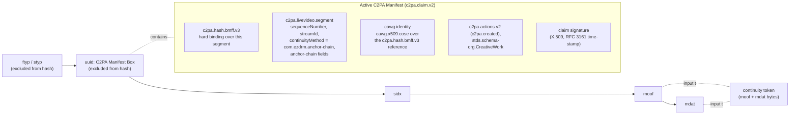
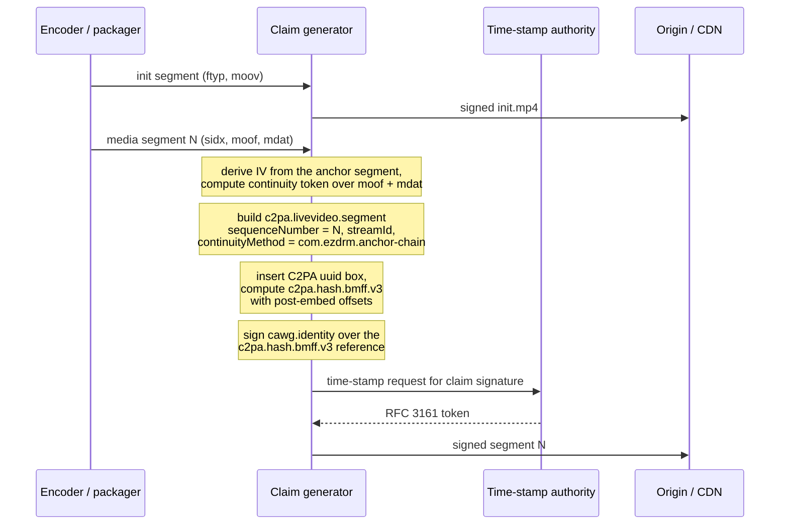
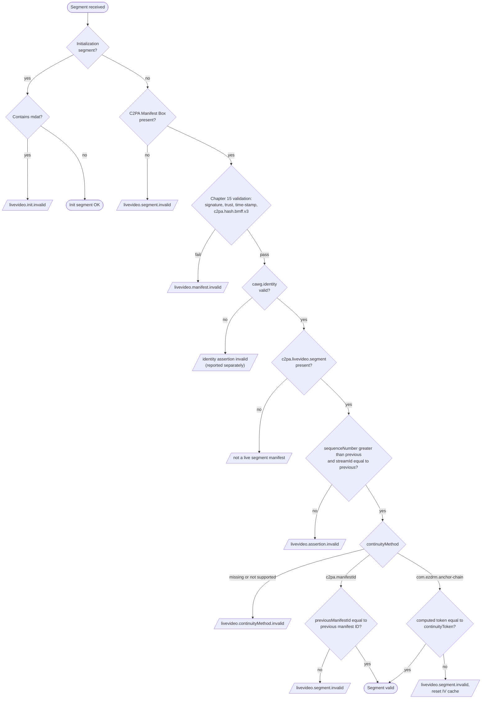
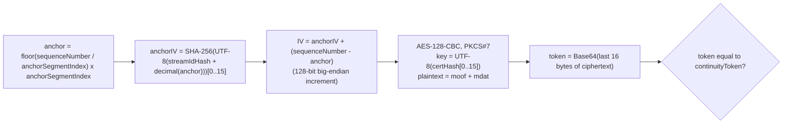
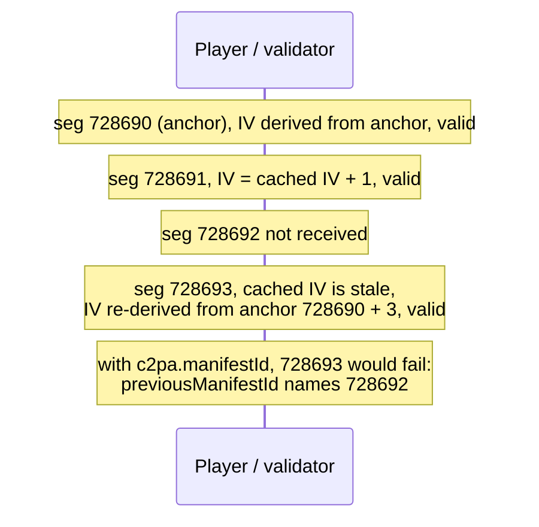

# C2PA Live Segment Validation (Per-segment C2PA Manifest Box method)

This document describes how to validate the live video segments in this
directory. They use the **Per-segment C2PA Manifest Box method** defined in
C2PA 2.3, Section 19.3. Every media segment carries its own C2PA Manifest in a
`uuid` box, and each segment is validated on its own, with continuity checked
against the previous segment. This method does not use session keys or
`verifiable-segment-info` (Section 19.4).

Continuity between segments uses an entity-specific continuity method,
`com.ezdrm.anchor-chain`, which Section 19.3.2 allows ("Implementers may define
additional continuity methods"). Each segment carries a continuity token
computed over its `moof` and `mdat` boxes with an IV that is chained from the
nearest anchor segment. Section 19.3.1 also allows this: "Claim generators may
derive additional per-segment validation values (e.g., anchor-point-based
chaining values) from segment hashes and embed them in the Manifest."

The segments in `m4s/` also carry a CAWG identity assertion
(`cawg.identity`), which binds a named signer to the segment's hard binding.

## Contents

- [Files](#files)
- [Segment structure](#segment-structure)
- [Generation flow](#generation-flow)
- [Validation flow](#validation-flow)
- [Validation steps](#validation-steps)
- [Missing segments](#missing-segments)
- [Checking this test set](#checking-this-test-set)
- [Known deviations in the current files](#known-deviations-in-the-current-files)

## Files

| Folder | Files | Content | Format | Signer |
|:--|:--|:--|:--|:--|
| `m4s/` | `init.mp4` and `seg_728690.m4s` to `seg_728709.m4s` (20 segments, two full anchor cycles: 728690 to 728699 and 728700 to 728709) | Clear | `c2pa.claim.v2`, `c2pa.livevideo.segment` with `continuityMethod` `com.ezdrm.anchor-chain`, `cawg.identity` | DigiCert S/MIME certificate |
| `mp4/` | `segment_11_12517098.mp4` to `segment_11_12517117.mp4` (20 segments) | CENC-encrypted (`pssh`, `senc`, `sgpd`/`sbgp` `seig` in each `moof`) | Earlier format: `c2pa.claim` (v1), continuity values in a `c2pa.IVHASH` action, no CAWG, no initialization segment | C2PA test signing certificate |

For the encrypted `mp4/` set, the `c2pa.hash.bmff.v3` hash and the continuity
token are computed over the encrypted samples, so validators need no content
keys.

`example_c2pa_manifest.json` is a decoded dump of the manifest store of
`m4s/seg_728690.m4s` (the first anchor segment). CBOR byte strings are shown
as `b64:` followed by their Base64 encoding.

## Segment structure

Each segment is a self-contained fMP4 media segment. The C2PA Manifest Box is a
`uuid` box with the C2PA user type `d8fec3d6-1b0e-483c-9297-5828877ec481`,
placed directly after the file or segment type box.



The `c2pa.hash.bmff.v3` assertion excludes the C2PA `uuid` box and the
`ftyp`, `styp`, `mfra`, `free` and `skip` boxes. In `m4s/seg_728690.m4s` the
claim lists `c2pa.hash.bmff.v3` as a created assertion, and
`c2pa.actions.v2`, `stds.schema-org.CreativeWork`, `c2pa.livevideo.segment`
and `cawg.identity` as gathered assertions.

The initialization segment `m4s/init.mp4` contains `ftyp`, a C2PA Manifest Box
and `moov`, and no `mdat`.

## Generation flow



## Validation flow



The first segment of a session has no previous segment, so the "previous"
comparisons are skipped for it.

## Validation steps

### Step 1: Check the box structure

Parse the top-level boxes of the segment. A media segment is expected to
contain a file or segment type box, a C2PA `uuid` box, `sidx`, then one `moof`
followed by one `mdat`.

- An initialization segment (one that contains `moov`) MUST NOT contain `mdat`,
  otherwise it fails with `livevideo.init.invalid`.
- A media segment without a C2PA Manifest Box fails with
  `livevideo.segment.invalid`.

```ts
type Box = { type: string; start: number; end: number; usertype?: string };

const C2PA_UUID = "d8fec3d61b0e483c92975828877ec481";

function readBoxes(data: Uint8Array): Box[] {
  const view = new DataView(data.buffer, data.byteOffset, data.byteLength);
  const boxes: Box[] = [];
  let pos = 0;
  while (pos + 8 <= data.length) {
    let size = view.getUint32(pos);
    const type = String.fromCharCode(...data.subarray(pos + 4, pos + 8));
    let header = 8;
    if (size === 1) {
      size = Number(view.getBigUint64(pos + 8)); // 64-bit largesize
      header = 16;
    } else if (size === 0) {
      size = data.length - pos; // box extends to end of file
    }
    if (size < header || pos + size > data.length) {
      throw new Error(`malformed box '${type}' at offset ${pos}`);
    }
    const box: Box = { type, start: pos, end: pos + size };
    if (type === "uuid") {
      box.usertype = [...data.subarray(pos + header, pos + header + 16)]
        .map((b) => b.toString(16).padStart(2, "0"))
        .join("");
    }
    boxes.push(box);
    pos += size;
  }
  return boxes;
}

const boxes = readBoxes(segment);
const isInit = boxes.some((b) => b.type === "moov");
const hasManifestBox = boxes.some((b) => b.type === "uuid" && b.usertype === C2PA_UUID);
if (isInit && boxes.some((b) => b.type === "mdat")) fail("livevideo.init.invalid");
if (!isInit && !hasManifestBox) fail("livevideo.segment.invalid");
```

### Step 2: Validate the C2PA Manifest (Chapter 15)

Validate the manifest with a conforming C2PA validator. This covers the claim
signature, the certificate chain against the validator's trust list, the
time-stamp, and the `c2pa.hash.bmff.v3` hard binding over the segment bytes.
If this fails, the segment fails with `livevideo.manifest.invalid`.

```ts
import { createC2pa } from "@contentauth/c2pa-web";
import wasmSrc from "@contentauth/c2pa-web/resources/c2pa.wasm?url";

const c2pa = await createC2pa({ wasmSrc, settings: toolkitSettings });
const reader = await c2pa.reader.fromBlob("video/mp4", new Blob([segment]));
const store = await reader.manifestStore();
const active = store.manifests[store.active_manifest];
if (store.validation_state === "Invalid") {
  fail("livevideo.manifest.invalid", store.validation_status);
}
```

`toolkitSettings` should load the trust list that the deployment uses. A
manifest signed with a certificate that is not on that list is reported with
`signingCredential.untrusted`.

### Step 3: Validate the CAWG identity assertion

Segments in `m4s/` carry a `cawg.identity` assertion with `sig_type`
`cawg.x509.cose`. Its `signer_payload.referenced_assertions` lists the
`c2pa.hash.bmff.v3` assertion by URL and hash, so the identity signature covers
the segment's hard binding. Validate it according to the CAWG Identity
Assertion specification: check that each referenced assertion hash matches,
verify the COSE signature, and check the signer's X.509 certificate against
the validator's CAWG trust configuration. c2pa-rs based validators report the
result alongside the C2PA validation results.

An invalid identity assertion is reported as an identity failure. It does not
change the result of the live video checks in Steps 4 to 6.

### Step 4: Read the live video segment assertion

Find the `c2pa.livevideo.segment` assertion in the active manifest. For
`m4s/seg_728690.m4s` it contains:

| Field | Value | Meaning |
|:--|:--|:--|
| `sequenceNumber` | `728690` | Monotonically increasing segment number (Section 19.3.2) |
| `streamId` | `https://undefined.s3.amazonaws.com/us-east-1` | Identifier for the whole live stream (see [known deviations](#known-deviations-in-the-current-files)) |
| `continuityMethod` | `com.ezdrm.anchor-chain` | Entity-specific continuity method |
| `anchorSegmentIndex` | `10` | An anchor segment occurs every N segments |
| `streamIdHash` | `o1q7p/yXXB+e2q1RXBCUfg==` | Base64 string, seed for the anchor IV |
| `certHash` | `dHGNvgfyQjWSbjROm73g/w==` | Base64 string. Its first 16 characters, as UTF-8 bytes, are the AES-128 key |
| `continuityToken` | `z+yZ/5aCTd+WVSRXk+8uRA==` | Expected token for this segment, Base64 |

```ts
const seg = active.assertions.find((a) => a.label === "c2pa.livevideo.segment")?.data;
```

In the earlier-format `mp4/` set, the anchor-chain values are the `parameters`
of a `c2pa.IVHASH` entry in an `actions` array inside
`c2pa.livevideo.segment`, and the segment number is called `segmentId`.

### Step 5: Apply the Section 19.7.2 checks

Keep the state of the previous segment of the same stream (`prev.seq`,
`prev.streamId`, `prev.manifestId`). Then:

1. `seg.sequenceNumber` MUST be greater than `prev.seq`. Otherwise:
   `livevideo.assertion.invalid`.
2. `seg.streamId` MUST equal `prev.streamId`. Otherwise:
   `livevideo.assertion.invalid`.
3. `seg.continuityMethod` MUST be present. Otherwise:
   `livevideo.continuityMethod.invalid`.
4. If `continuityMethod` is `c2pa.manifestId`, `seg.previousManifestId` MUST be
   present (otherwise `livevideo.continuityMethod.invalid`) and MUST equal
   `prev.manifestId` (otherwise `livevideo.segment.invalid`).
5. If `continuityMethod` is `com.ezdrm.anchor-chain`, validate the continuity
   token ([Step 6](#step-6-validate-the-anchor-chained-continuity-token)).
6. If `continuityMethod` is any other value the validator does not support:
   `livevideo.continuityMethod.invalid`.

```ts
if (prev) {
  if (!(seg.sequenceNumber > prev.seq) || seg.streamId !== prev.streamId) {
    fail("livevideo.assertion.invalid");
  }
}
switch (seg.continuityMethod) {
  case undefined:
    fail("livevideo.continuityMethod.invalid");
    break;
  case "c2pa.manifestId":
    if (!seg.previousManifestId) fail("livevideo.continuityMethod.invalid");
    if (prev && seg.previousManifestId !== prev.manifestId) fail("livevideo.segment.invalid");
    break;
  case "com.ezdrm.anchor-chain":
    await checkAnchorChain(seg, segment, boxes); // Step 6
    break;
  default:
    fail("livevideo.continuityMethod.invalid");
}
prev = { seq: seg.sequenceNumber, streamId: seg.streamId, manifestId: store.active_manifest };
```

### Step 6: Validate the anchor-chained continuity token



1. **Extract the input bytes.** Concatenate the raw bytes of the `moof` box and
   the `mdat` box that follows it, including their headers. No other box is
   part of the input. For encrypted segments these are the encrypted bytes as
   stored in the file.
2. **Derive the anchor IV.** `anchor = floor(sequenceNumber /
   anchorSegmentIndex) * anchorSegmentIndex`. `anchorIV` is the first 16 bytes
   of `SHA-256(UTF-8(streamIdHash + String(anchor)))`. `streamIdHash` is used
   as its Base64 string, not decoded.
3. **Advance to the segment IV.** Increment `anchorIV` as a 128-bit big-endian
   integer `sequenceNumber - anchor` times. A validator that holds the IV of the
   previous segment (`sequenceNumber - 1`) and is not at an anchor may
   increment that IV once instead.
4. **Compute the token.** Encrypt the input bytes with AES-128-CBC and PKCS#7
   padding, using `UTF-8(certHash.slice(0, 16))` as the key and the segment IV.
   The token is the Base64 encoding of the last 16 bytes of the ciphertext
   (a CBC-MAC).
5. **Compare.** If the computed token equals `continuityToken`, the check
   passes. Otherwise the segment fails with `livevideo.segment.invalid`, and
   any cached IV is cleared so the next anchor segment starts a clean chain.

```ts
const utf8 = (s: string) => new TextEncoder().encode(s);

function moofAndMdat(data: Uint8Array, boxes: Box[]): Uint8Array {
  const i = boxes.findIndex((b) => b.type === "moof");
  if (i < 0 || boxes[i + 1]?.type !== "mdat") throw new Error("moof + mdat not found");
  return data.slice(boxes[i].start, boxes[i + 1].end);
}

function incrementIv(iv: Uint8Array, times = 1): Uint8Array {
  const out = new Uint8Array(iv);
  for (let n = 0; n < times; n++) {
    for (let i = out.length - 1; i >= 0; i--) {
      out[i] = (out[i] + 1) & 0xff;
      if (out[i] !== 0) break;
    }
  }
  return out;
}

async function segmentIv(seq: number, anchorSegmentIndex: number, streamIdHash: string) {
  const anchor = Math.floor(seq / anchorSegmentIndex) * anchorSegmentIndex;
  const digest = new Uint8Array(
    await crypto.subtle.digest("SHA-256", utf8(streamIdHash + anchor.toString()))
  );
  return incrementIv(digest.slice(0, 16), seq - anchor);
}

async function continuityToken(input: Uint8Array, certHash: string, iv: Uint8Array) {
  const key = await crypto.subtle.importKey(
    "raw", utf8(certHash.slice(0, 16)), { name: "AES-CBC" }, false, ["encrypt"]
  );
  // WebCrypto AES-CBC always applies PKCS#7 padding
  const ct = new Uint8Array(await crypto.subtle.encrypt({ name: "AES-CBC", iv }, key, input));
  return btoa(String.fromCharCode(...ct.slice(-16)));
}

async function checkAnchorChain(seg: any, segment: Uint8Array, boxes: Box[]) {
  const iv = await segmentIv(seg.sequenceNumber, seg.anchorSegmentIndex, seg.streamIdHash);
  const token = await continuityToken(moofAndMdat(segment, boxes), seg.certHash, iv);
  if (token !== seg.continuityToken) {
    clearIvCache();
    fail("livevideo.segment.invalid");
  }
}
```

**Security note.** The AES key and the IV are derived only from values that
are in the manifest. Anyone who can read the manifest can recompute the token,
so it shows that the `moof`/`mdat` bytes are consistent with the manifest but
does not by itself authenticate them. Authenticity comes from the signed
manifest and its `c2pa.hash.bmff.v3` hard binding (Step 2).

### Step 7: Report the result

A segment is **valid** when Steps 1, 2, 5 and (for `com.ezdrm.anchor-chain`) 6
pass. The CAWG identity result from Step 3 is reported alongside. Report
failures with the status codes above. On any failure, clear the cached
previous-segment state and IV so that the next segment, or the next anchor
segment for Step 6, starts a new chain.

## Missing segments

Live delivery regularly loses or skips segments, for example when a player
joins mid-stream, switches renditions or drops a segment that arrived late.

- With **`c2pa.manifestId`**, every segment names the manifest of the segment
  before it. If segment N is missing, segment N+1 carries a
  `previousManifestId` that the validator has never seen, so N+1 fails with
  `livevideo.segment.invalid`. The chain can only be restarted by out-of-band
  means.
- With **`com.ezdrm.anchor-chain`**, the IV of every segment can be derived
  from its own `sequenceNumber` and the anchor index alone. A validator that
  misses segment N derives the IV of N+1 from the anchor (Step 6.2 and 6.3)
  instead of incrementing a cached IV, and N+1 validates normally. The
  `sequenceNumber` check in Step 5 still passes, because it only requires an
  increase. Only the missing segment itself is lost.



## Checking this test set

1. **Box structure.** List the top-level boxes, for example with GPAC:

   ```bash
   MP4Box -info m4s/init.mp4
   ```

   ```bash
   MP4Box -info m4s/seg_728690.m4s
   ```

   `init.mp4` contains `ftyp`, the C2PA `uuid` box and `moov`. Each media
   segment contains `ftyp`, the C2PA `uuid` box, `sidx`, `moof` and `mdat`.
2. **Manifest.** Read each segment with a C2PA validator (c2pa-rs, c2pa-web or
   c2patool), with `init.mp4` where the reader needs it, and record
   `validation_state` and `validation_status`.
3. **Hard binding.** Confirm that `c2pa.hash.bmff.v3` validates for every
   segment (`assertion.bmffHash.match`).
4. **CAWG identity.** Confirm that `cawg.identity` validates for every segment
   in `m4s/`.
5. **Live video checks.** Run Steps 4 and 5 over each folder in segment order.
   In `m4s/`, `sequenceNumber` runs from 728690 to 728709 in steps of one and
   `streamId` is constant.
6. **Continuity tokens.** Run Step 6 over each folder. All 20 tokens in `m4s/`
   (anchors 728690 and 728700) and all 20 tokens in `mp4/` recompute
   correctly with the algorithm above.
7. **Negative checks.**
   - Flip one byte in an `mdat`: Step 2 (`assertion.bmffHash.mismatch`) and
     Step 6 both fail.
   - Swap two segments: Step 5 fails.
   - Remove one segment from the middle of `m4s/`: the following segment still
     validates by re-deriving its IV from the anchor
     ([Missing segments](#missing-segments)).

## Known deviations in the current files

### `m4s/` (current format)

| Issue | Spec reference | Effect |
|:--|:--|:--|
| `streamId` is `https://undefined.s3.amazonaws.com/us-east-1`: a value was undefined when the identifier was built | 19.3.2 | Valid as a string, but not a meaningful stream identifier |
| `sequenceNumber` is one less than `mfhd.sequence_number` (728690 against 728691) | 19.3.2, 19.4 `sequenceNumber` | `sequenceNumber` should match `mfhd.sequence_number` or follow ISO/IEC 23009-9 segment indexing |
| The manifest in `init.mp4` uses `c2pa.claim` (v1), `c2pa.hash.bmff.v2` and a `urn:uuid:` label. The media segments already use `c2pa.claim.v2`, `c2pa.hash.bmff.v3` and `urn:c2pa:` | 8, 10, Appendix C | Deprecated constructs. Validators accept them, but generators must not write them |
| Media segments start with `ftyp` rather than `styp` | ISO/IEC 14496-12 | Media segments normally start with `styp`. Both are excluded from the hash |
| The anchor-chain fields (`anchorSegmentIndex`, `streamIdHash`, `certHash`, `continuityToken`) are not namespaced | 19.3.2, 6.2 | Fields added by other continuity methods should be named as labels, for example `com.ezdrm.continuityToken` |
| `com.ezdrm.anchor-chain` is an entity-specific continuity method | 19.7.2 | Validators that do not support it report `livevideo.continuityMethod.invalid` for every segment, by design |

### `mp4/` (earlier format)

| Issue | Spec reference | Effect |
|:--|:--|:--|
| `c2pa.livevideo.segment` has no `sequenceNumber`, `streamId` or `continuityMethod`. It contains `all` and an `actions` list instead | 19.3.2 | `livevideo.continuityMethod.invalid` on every segment |
| Continuity values are carried in a custom action named `c2pa.IVHASH`. Entity-specific action names must use the entity's reverse domain name | 6.2, 18.15 | Unknown action in the reserved `c2pa.` namespace |
| Claim uses `c2pa.claim` (v1), a v1 `sigTst` time-stamp and `urn:uuid:` labels | 8, 10, Appendix C | Deprecated constructs |
| `mfhd.sequence_number` does not match `segmentId` | 19.3.2 | Inconsistent segment numbering |
| No initialization segment is included | 19.7.1 | The segments cannot be decoded on their own |
